# Cyclone — Entity Relationship Diagrams

Ten subject-area diagrams. Split deliberately: one ERD covering every table is
unreadable, and crossings grow much faster than node count. `MATTERS` and
`STAFF` repeat across frames so each frame can stay small.

Vetted line by line against the deployed schema after migration 037. Every
cardinality below traces to a column's nullability and its foreign key — if you
change a column between `NULL` and `NOT NULL`, the diagram needs updating too.

**047 adds frame 6a**, the document pipeline: the file as produced, the working
documents split from it, and the label-to-request spine the Rule 196.3(c)
production index is composed from. 048 is a CHECK widening only.

**033 adds the tenth frame.** `transaction_payee_classifications` records what
the firm has decided a payee *is*, and 036 widened it from two verdicts to
three. 034–037 are otherwise columns only: statement boundary markers, the
production-scope dates, an account type, and a brokerage statement's portfolio
summary — each noted under the frame that draws its table.

Four foreign keys that had never been drawn are now in: `clients` referred to a
staff member, `billing_cycles` closed by one, `matter_events` created by one,
and `matter_pleadings` ingested by one. They were omissions rather than
decisions — an undrawn foreign key is the kind of thing a reader assumes does
not exist, and two of these four are `NOT NULL`, so every row in those tables
carries one.

## Notation

| Marker | Meaning |
| ------ | ------- |
| `\|o` | zero or one |
| `\|\|` | exactly one |
| `}o` | zero or more |
| `}\|` | one or more |
| `--` | enforced by a foreign key |
| `..` | reference with **no** foreign key — a cross-database join, or a link deliberately left unenforced |

Two rules that account for nearly every error worth catching:

1. **A nullable foreign key is `|o` / `o|` on the parent side, never `||`.**
2. **Markers are sided.** Zero-or-one is `|o` on the left of the line and `o|`
   on the right. `STAFF o|--o{ JOBS` puts a right-hand marker in a left-hand
   slot and renders wrong.

Labels read as a sentence from the left entity outward — *OFFICES houses
STAFF*. Mixed direction is what makes an ERD hard to read aloud.

---

## 1. People and access

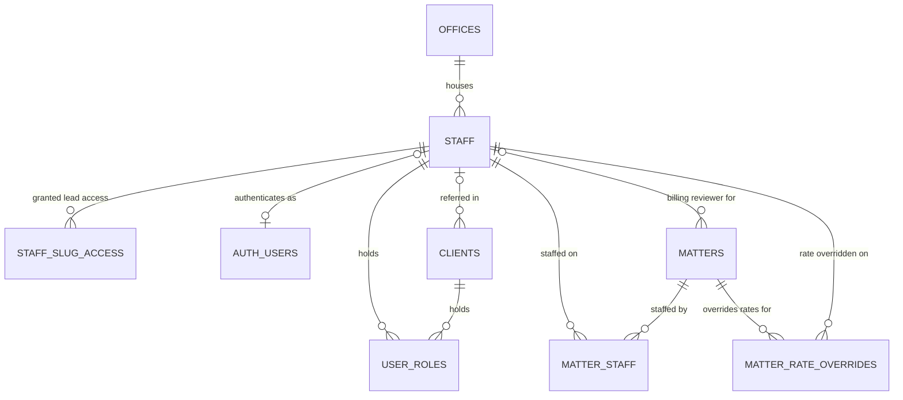

- `staff.supabase_uid` is nullable — a staff row exists before that person ever
  logs in — so `AUTH_USERS` is `|o--o|`. It lives in the `auth` schema, outside
  the one we control; named without a dot because a dot breaks the parser.
- One person holds several roles as separate `user_roles` rows. **Clients hold
  roles too**, which migration 021 unblocked.
- `matters.billing_review_staff_id` is nullable: zero or one reviewer per
  matter, many matters per reviewer.
- `clients.referred_to_staff_id` (migration 019) is who brought the client in.
  Nullable — a client can arrive without one — and **not** the same question as
  `clients.referral_source`, which is free text about *how* they found the firm.
  This column names a person in the building, which is why it has a foreign key
  and the other does not.

## 2. Split billing

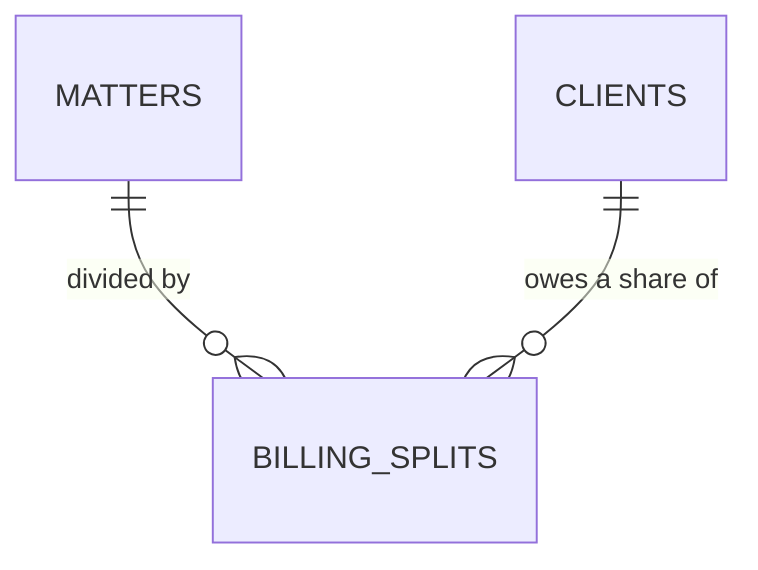

`billing_splits` divides the **bill** between multiple clients on one matter.
Attorney revenue split is `matter_staff.split_pct` where `role = 'originating'`
— a different table. Both foreign keys here are `NOT NULL`, so this is a plain
junction, not a many-to-many on both sides.

## 3. Leads and the agent

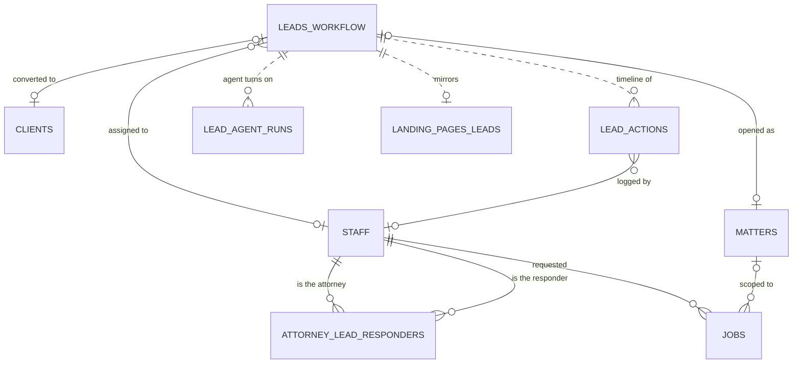

- Lead rows themselves live in the **landing-pages** project; this database
  holds `leads_workflow`, joined in Python. `LANDING_PAGES_LEADS` is drawn on a
  dashed edge to mark the boundary.
- Every `foreign_session_uuid` edge is dashed: there is no foreign key behind
  it, so nothing prevents an orphan.
- `lead_actions.staff_id` is nullable — the agent logs actions with no human
  behind them.
- `attorney_lead_responders` gets two labelled edges because both of its columns
  point at `staff`; one edge would hide that it pairs two people.
- `jobs.matter_id` is nullable because the queue predates it: a matter-intake
  job runs *before* the matter exists, so only jobs raised from inside a matter
  — statement ingestion, so far — carry one.
- `jobs.params` (migration 025) holds the options a job was *started* with, the
  counterpart to `result`. First use is the Bates prefix override: typed at the
  upload, needed by the worker minutes later in another process.

## 4. Money and the calendar

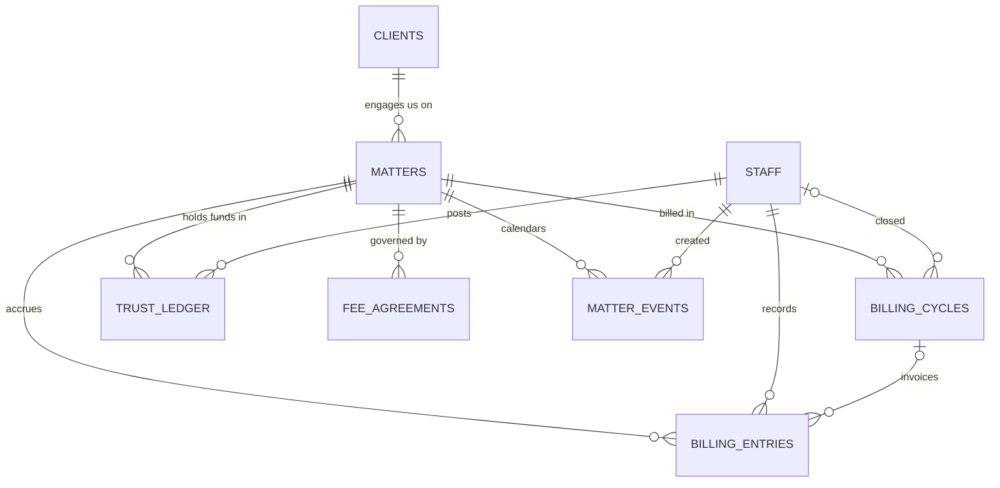

- A client can exist with no matter — that is what a prospect is, and what
  intake creates before the matter row.
- `billing_entries.billing_cycle_id` is nullable: an unbilled entry has no cycle
  yet, which is the point of the `v_unbilled_entries` view.
- Nothing constrains a matter to one fee agreement, and the status enum includes
  `voided` — which only makes sense if a replacement can follow.
- `billing_cycles.closed_by_staff_id` is nullable and `matter_events.created_by_staff_id`
  is not, and the difference is the whole lifecycle: a cycle exists while it is
  open and nobody has closed it, where an event cannot exist without whoever put
  it on the calendar. Closing a cycle is an audited action (§13), so the column
  is the record of who did it rather than a convenience.

> `fee_agreements.template_id` is not drawn: it references a `templates` table
> that does not exist anywhere in the schema. Dead column or missing table.

## 5. The case file

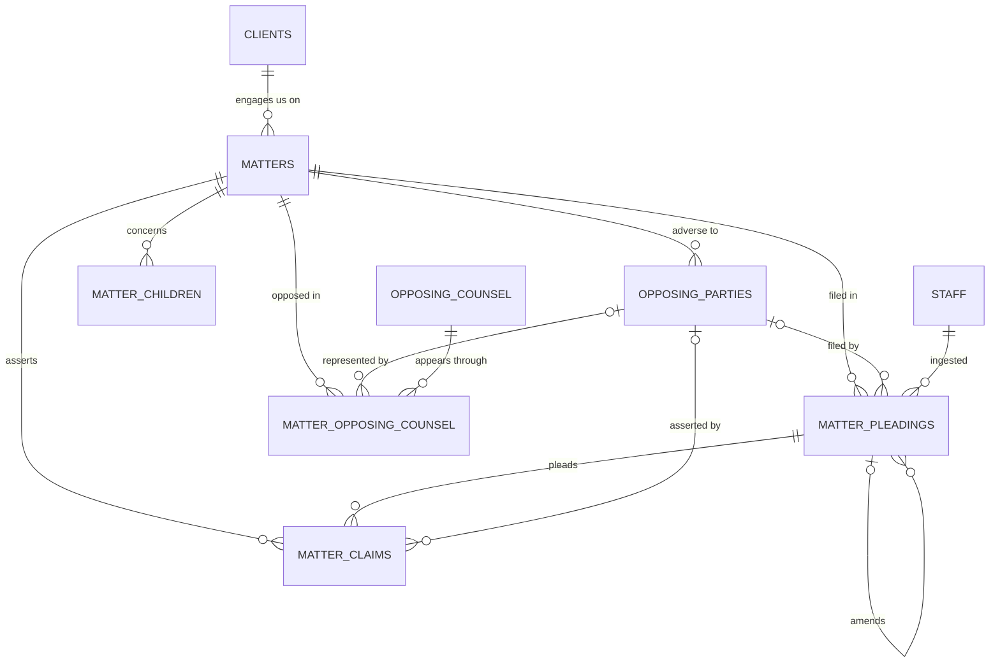

- The three `OPPOSING_PARTIES` edges carry the case's meaning: which party filed
  a pleading, whose claim a claim is, and which party an attorney appears for.
  All three are nullable.
- `amends_pleading_id` is the amendment chain that drives
  `status = 'superseded'`, so the self-relation is worth drawing.
- `opposing_counsel` is the shared attorney record, deduplicated on
  `(bar_state, bar_number)`; a junction row points at exactly one.
- A matter opened from a phone call has no pleading at all.
- `matter_pleadings.ingested_by_staff_id` is `NOT NULL`, so `STAFF` appears in
  this frame for one edge. Worth the extra node: a pleading carries `raw_text`
  and a `storage_path`, and every document in this schema records who put it
  there — the same rule as discovery in frame 6 and statements in frame 7.

## 6. Discovery

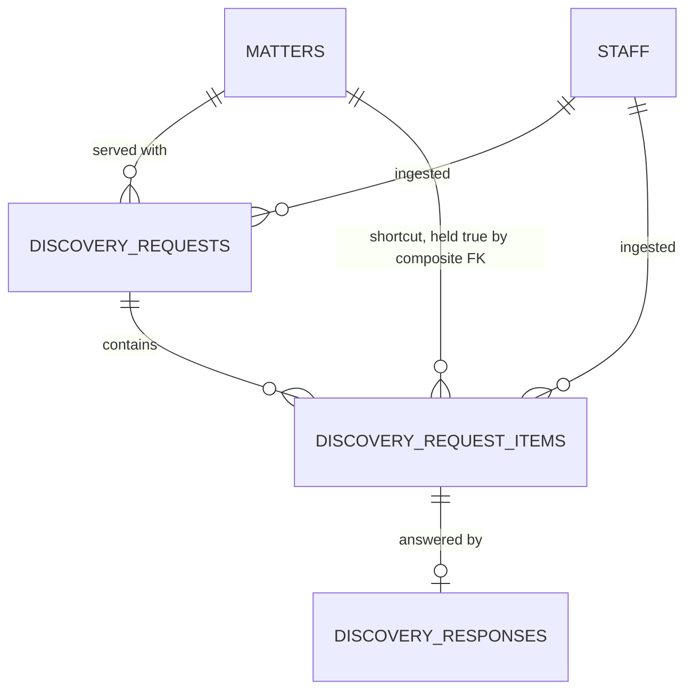

Split out of diagram 5 — it was the densest corner, and it is now the cleanest
chain in the schema.

- `discovery_responses.discovery_request_id` is `UNIQUE`, so at most one
  response per item; an item awaiting the client has none yet.
- `discovery_request_items.matter_id` is a denormalized shortcut that keeps
  `get_by_matter` and `get_pending_client` single-table. Since migration 022 a
  composite foreign key on `(discovery_request_id, matter_id)` guarantees it
  equals the parent document's, so the shortcut cannot lie.

---

## 6a. The document pipeline

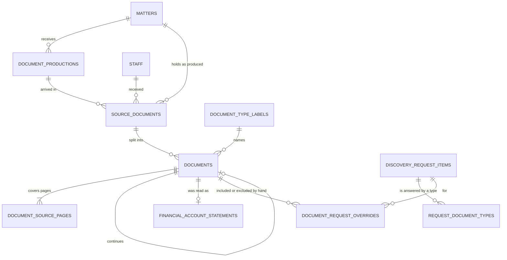

Added by migration 047. It sits between diagram 6 and diagram 7 because that is
where it sits in the work: a production arrives, is split into documents, and
some of those documents turn out to be account statements.

**The two halves are not the same thing and the split is the point.**
`SOURCE_DOCUMENTS` is the file exactly as it was served — hashed on receipt,
never OCR'd, split or re-saved. `DOCUMENTS` are the working copies cut out of
it. Lineage is a column, not an afternoon of matching mangled filenames.

- `source_documents` is unique on `(matter_id, content_sha256)`. One matter
  cannot hold the same bytes twice; across matters it can, because the same
  bank statement produced in two cases is two records.
- **`DOCUMENT_SOURCE_PAGES` is a LIST, which is why the relationship is
  `||--|{`.** A document interrupted mid-way by unrelated pages and resumed
  later is one document with two ranges. An exclusion constraint stops one
  document claiming a page twice — and there is deliberately **no** constraint
  across documents, because a combined statement prints one account's close and
  the next account's opening on the same sheet.
- `documents.continues_document_id` is the self-reference for the *automatic*
  path, where nobody has asserted two fragments are one document. Where a
  person groups them on the bench, they are one document with two ranges
  instead.
- `documents.statement_id` is `NULL` when a document held **several**
  statements, not just when it held none. Picking one of them would make the
  production index cite that account's period for all of them.
- `request_document_types` is one judgment per *(request, label)* rather than
  per *(document, request)*: six labels against twenty requests is 120
  decisions made once, and every document produced later inherits by its label.
  `document_request_overrides` is the per-document exception, in both
  directions, and is a row rather than a deletion — a suppression has to say
  who made it.

The three views over this — `production_index`, `unmapped_documents` and
`requests_without_documents` — are `security_invoker` and revoked from the
public key, as is `document_page_spans`, which derives a document's outer page
span rather than storing it beside the ranges.

---

## 7. Account statements

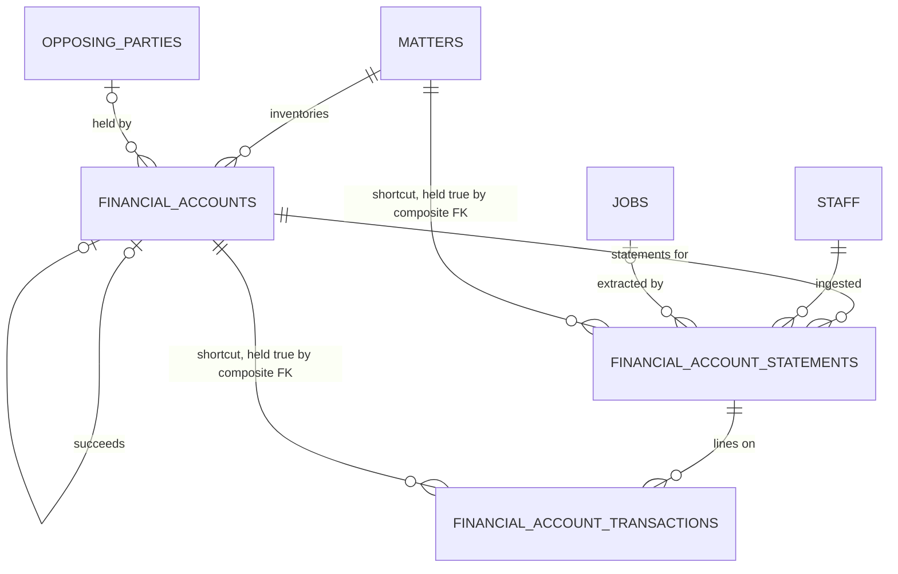

The source of the inventory, the settlement spreadsheet, and the waste and
reimbursement exhibits. Added by migration 023.

- `financial_accounts.opposing_party_id` is nullable and means "held by the
  other side"; `NULL` is our own client's account, not missing data.
- `property_character` is nullable on purpose. Characterization is argued, not
  extracted, so a freshly ingested account has none until an attorney sets one.
- Both denormalized shortcuts follow the pattern established in diagram 6:
  `financial_account_statements.matter_id` and
  `financial_account_transactions.financial_account_id` each carry a composite
  foreign key back to the parent's `(id, <key>)` unique constraint, so neither
  can drift from the row above it.
- `source_job_id` is nullable and `ON DELETE SET NULL` — a statement outlives
  the job that produced it, and job rows are prunable.
- A statement is unique on `(financial_account_id, period_start, period_end)`
  only where `review_status <> 'rejected'`. Rejecting a bad extraction frees
  the period so the same PDF can be run again.
- `ownership` (migration 026) says who holds the account: `client_sole`,
  `opposing_sole`, `joint`, `third_party`, `unknown`. It exists because
  `opposing_party_id` alone could not express *joint*, and a jointly held
  account is the difference between an asset one side keeps and an asset the
  court divides. `opposing_party_id` now names *which* other party — sole owner
  or co-holder. It defaults to `unknown`, not `client_sole`: every existing row
  was created by extraction, which never determined this.
- The transaction→statement composite FK is `ON UPDATE CASCADE` since migration
  026, which is what makes an account merge possible. Moving a statement changes
  a key its transactions point at; under the default `NO ACTION` there is no
  order of updates that works, in either direction.
- `antecedent_account_id` is the one self-reference in the schema. A reissued
  card or a bank migration produces several accounts with different numbers;
  read separately they look like three half-produced accounts with alarming
  gaps, and read as a chain they are one continuous history. It points
  *backwards* so a new number can be linked the day it appears, and a partial
  unique index keeps a chain single-file — two accounts cannot claim the same
  predecessor, or "what came next" stops having one answer.

Four columns arrived after 032 and none of them changes an edge. They are here
because each records a judgment or a second reading that no foreign key can
express:

- **`financial_account_statements.boundary`** (034) — `opening`, `closing`, or
  the default `intermediate`. It is what tells a gap in a production from the
  edge of an account's life, and **nobody can extract it**: a statement does not
  say it is the first, and an opening balance of zero is not proof, because
  accounts are swept to zero routinely. So it sits with `ownership` and
  `property_character` as something a person marks, defaulted to the cautious
  answer.
- **`financial_accounts.production_responsibility`** (035) — `client`,
  `opposing`, `both`, `unknown`. Deliberately **not derived from `ownership`**,
  which is the neighbouring column and usually agrees: one decides how an asset
  divides, the other whose motion to compel it is, and deriving either from the
  other would be a legal conclusion drawn by a schema. Its partners are
  `matters.client_produces_since` and `matters.opposing_produces_since`, the
  look-back dates that bound each side's obligation — **named for who produces,
  not who asked**, because the date opposing counsel propounded is the one that
  binds our client.
- **`financial_account_statements.portfolio_summary`** (037) — a brokerage
  statement's own change-in-value block, stored beside the extraction as an
  independent source. Null on every other account type. It exists because
  change in market value enters as an ordinary transaction line, so the usual
  `beginning + sum == ending` check closes against whatever that line says; the
  summary is the second reading that catches a withdrawal nobody extracted.
- **`financial_accounts.account_type` gained `crypto`** (036), alongside the
  custodian rulings in frame 10. An exchange balance is an account somebody has
  to produce, and it was previously filed under `other` with everything else.

---

## 8. Classifying transactions

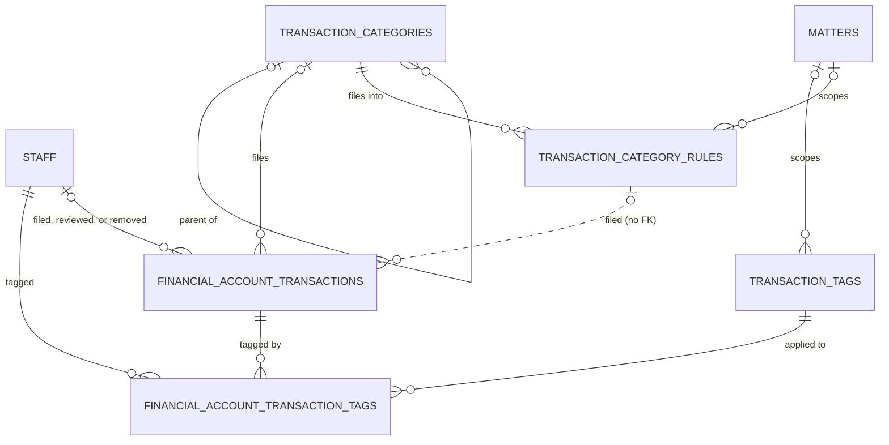

Two axes over the same rows, deliberately built from different mechanisms
because they answer different questions. Added by migration 024.

- **Category is one per line**, a firm-wide hierarchy nesting to arbitrary
  depth (Housing > Utilities > Gas). It drives the Financial Information
  Statement — the personal income statement filed for a temporary orders
  hearing — where a line in two buckets double-counts. Firm-wide rather than
  per-matter so an FIS is comparable across cases.
- **Tags are many-to-many**, in two layers held in one table: `matter_id` NULL
  is a firm-wide tag offered everywhere ("Waste Claim"), a value scopes it to
  one case ("Waste: Sister's Wedding"). They drive the Rule 1006 summaries, and
  a single line is routinely evidence in several exhibits at once — which is
  exactly why this cannot be a column.
- `include_in_fis` is what keeps a stock split off the income statement: money
  that moves without being income or expense.
- `category_id` is `ON DELETE RESTRICT`, not `SET NULL`. Quietly un-filing
  evidence because someone tidied the chart is how an FIS loses a line with
  nobody noticing; retiring a category sets `is_active` instead.
- `financial_account_transactions.deleted_at` (migration 028) is the one soft
  delete in the schema. Statements and accounts are removed outright, because
  the PDF in Storage is the undo; a line is not, because dropping one asserts
  it is not printed on the document and changes whether the statement
  reconciles. Every read excludes them by default, and the matter-close
  workflow is meant to sweep them.
- The join table carries `tagged_by_staff_id`. Tagging is an attorney judgment
  that gets cross-examined, so the record says who made it.
- The join table also carries a surrogate `id` on top of its natural
  `(transaction_id, tag_id)` key, purely so `BaseRepository`'s update and
  delete by id work unchanged.

Migration 032 adds keyword rules and, first, the provenance that makes them
answerable.

- **`transaction_category_rules` uses the same two layers as tags**: `matter_id`
  NULL is a firm-wide rule, a value scopes it to the client whose EXXON lines are
  revenue rather than fuel. `applies_to` constrains a rule by sign, because
  PAYROLL arriving is income and PAYROLL leaving is an expense.
- **`category_rule_id` is drawn `..`, with no foreign key, on purpose.** A rule
  is editable and deletable; the record that a rule filed this line has to
  outlive it. The moment that record is most wanted is right after somebody
  deletes the rule that caused the problem they are investigating — a real FK
  would either block that delete or erase the evidence of it.
- `category_source` says whether a person, a rule, or a similarity match filed
  the line. NULL means never categorized, which is **not** the same as a person
  deciding it belongs nowhere; that case is a human source with a null
  `category_id`.
- `category_reviewed_at` exists so reviewed-and-correct is distinguishable from
  never-looked-at. Without it the work queue never empties, because confirming
  an automatic assignment would leave no trace.
- **Three** staff references are nullable and point at the same table, which is
  why `STAFF |o--o{ FINANCIAL_ACCOUNT_TRANSACTIONS` appears once for three
  columns: who filed it (`category_set_by_staff_id`), who later confirmed it
  (`category_reviewed_by_staff_id`), and who dropped it
  (`deleted_by_staff_id`). All three are the same argument — an assertion about
  evidence is attributable — and drawing three parallel edges would say nothing
  the label does not.
- Whether a payee is a creditor is the other question asked of these rows, and
  it is answered by `transaction_categories.is_liability` (033) or by a ruling.
  See frame 10.

---

## 9. The Financial Information Statement

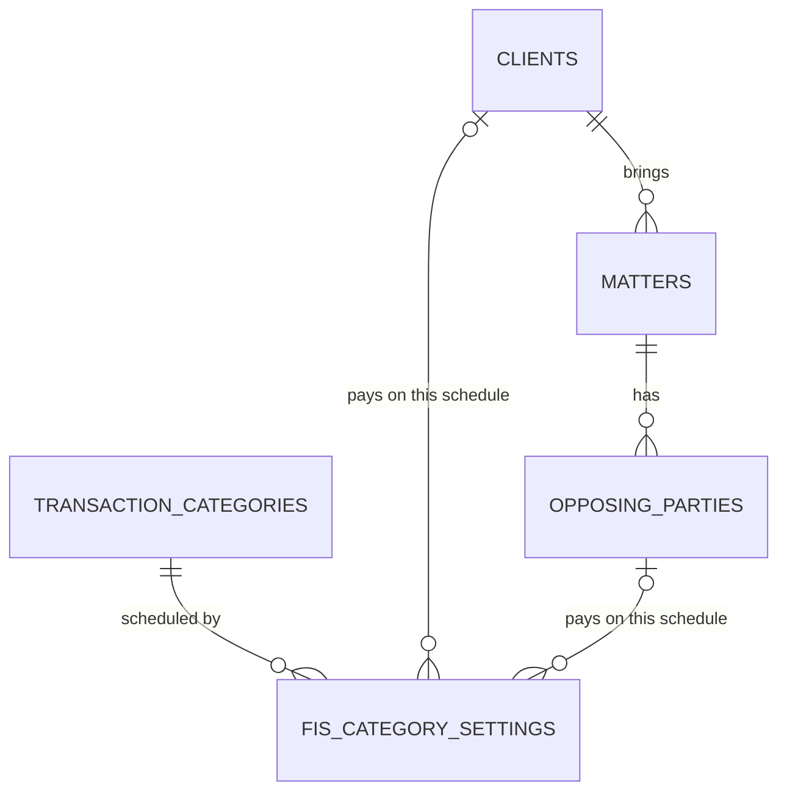

How often a category is paid, which is arithmetic rather than decoration. The
FIS reports an average **monthly** figure, and for anything paid less often than
monthly, dividing the window total by the window's months is wrong in a way that
moves: $3,600 of property tax paid once in January reads as $1,800/month over
January–February and $1,200 over January–March. Same facts, a different sworn
figure every time the report is re-run. Added by migration 031.

- **Scoped to the person, not the matter.** A payment schedule is a fact about
  someone's finances, not about a lawsuit — the same client may have matters in
  several counties from successive marriages and pays property taxes on the same
  schedule in all of them. Both party columns are nullable and at most one is
  set; **neither set is the firm-wide default** ("property taxes are usually
  annual"), the same two-layer shape as tags and category rules.
- A `CHECK` enforces that `client_id` and `opposing_party_id` are never both
  set. Three partial unique indexes give one row per category at each of the
  three scopes — a plain unique index would not, because NULL is not distinct
  from NULL.
- **`opposing_parties` is itself matter-scoped**, so settings for the other side
  stay with that matter while a client's follow the client across cases. That
  falls out of the existing schema rather than being chosen here, and it is why
  the two edges look symmetrical but do not behave alike.
- `stated_annual_amount` is the attorney's own figure and overrides anything
  derived. It is **signed**, like every other amount in the schema, because the
  reason to state a figure at all is that the transactions do not show one — so
  there is no sign to borrow.
- No table records the statement itself. It is computed on demand from the
  transactions as they stand, which is what lets re-filing one line change it.

---

## 10. What a production does not contain

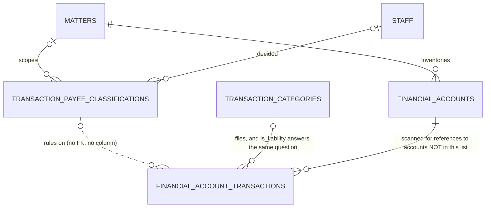

A production names the accounts it does not contain: the statement you *do*
have prints the number, the payee, or the platform of the one you do not.
Matching those against the accounts on the matter leaves the ones nobody
produced. Added by migration 033 and widened by 036.

**This is a third classification axis and it does not belong in frame 8**, for a
structural reason rather than a tidiness one: category and tags classify a
**row**, and both leave something on the row — a `category_id`, a join-table
entry. A payee ruling classifies a **string**. Nothing on the transaction points
at it, there is no `payee_classification_id`, and the report is recomputed from
the transactions on every read.

- **The dashed edge is weaker than frame 8's dashed edge.** There,
  `category_rule_id` at least stamps which rule filed a line, so the trail
  survives the rule's deletion. Here there is no column at all: matching happens
  at query time against the description *and* the scraped payee. Deleting a
  ruling is therefore safe in a way most deletes in this schema are not — a
  ruling is an opinion about a payee, not evidence, and the next read simply
  reflects the new answer.
- **Two layers in one table, the same shape as tags and category rules.**
  `matter_id` NULL is the firm's answer; a value overrides it for one case. Two
  **partial** unique indexes on `lower(btrim(pattern))` — one `where matter_id
  is null`, one `where matter_id is not null` — because a plain unique index
  cannot express this: NULL is not distinct from NULL. The same argument as the
  three partial indexes in frame 9.
- **`classification` carries three verdicts, and 036 added the third.**
  `creditor` (a debt is owed), `not_creditor` (a vendor — suppresses the payee),
  and `custodian` (the counterparty *holds* value: a wallet, an exchange, a
  brokerage). A payee can be a custodian **and** `not_creditor` at once — Venmo
  is exactly that — so the two are matched against separate lists. One table,
  two independent questions.
- **`holds text[]` is required for a custodian and forbidden for anything else**,
  enforced by a `CHECK` on both sides. That set is what a request for production
  asks for, and a custodian row without it says a platform holds *something*
  while naming nothing to demand. Its values are the account types the report
  can discharge: `deposit`, `brokerage`, `crypto`, `retirement`, `credit_card`,
  `line_of_credit`, `loan`, `other`.
- **`decided_by_staff_id` is nullable, and that nullability is the seeds.** A
  ruling made in the app is attributed, because `not_creditor` suppresses
  evidence from a report that backs a motion to compel and that must always be
  somebody's recorded decision. The rows migrations 033 and 036 seed — national
  card issuers, mortgage servicers, the buy-now-pay-later lenders, and around
  three dozen custodians — have no author. **Suppressions are never seeded**;
  only findings are.
- **The other source of the same answer is a column in frame 8**:
  `transaction_categories.is_liability` (033). A paralegal filing a line under
  "Credit Card Payments" *is* asserting a debt is owed, made as ordinary work,
  so the report reads it as a source and says which one it used for every row.
  Nothing in a payment description can settle it — "Online Payment To Mr.
  Cooper" (a mortgage servicer) and "Online Payment To Frontier" (an ISP) are
  the same sentence.
- The scan runs over **deposit-side accounts only**, which is why
  `FINANCIAL_ACCOUNTS` is in the frame: it is both the thing being scanned and
  the list a reference is checked against. An account already on the matter is
  never reported, including the statement's own number.

---

## Tables no diagram shows

Standalone by design — nothing references them and they reference nothing.
Adding them would cost clarity and return nothing.

| Table | Why it stands alone |
| ----- | ------------------- |
| `audit_log` | Deliberately polymorphic; `entity_id` is text so it can point at any table without a foreign key |
| `standard_privileges`, `standard_objections`, `kb_articles` | Lookup and content tables — copied from, never joined to |
| `telegram_users`, `processed_inbound_emails` | Integration bookkeeping |
| `v_matter_summary`, `v_unbilled_entries` | Views, not tables |

## Keeping the crossings down

Reordering statements will not fix crossings. Mermaid lays ER diagrams out with
dagre, which derives positions from the graph itself; there is no way to pin an
entity. What actually helps:

- **Fewer entities per frame.** Crossings grow far faster than node count.
  Splitting discovery out of diagram 5 removed most of the tangle in one move.
- **Declare each hub's edges together.** Keeping every `MATTERS` line adjacent
  gives dagre a cleaner ordering than interleaving hubs.
- **Repeat the hubs across diagrams.** That is what lets each frame stay small.
- **Try `direction LR`** as the first line inside `erDiagram`. Wide, shallow
  graphs like diagram 4 often untangle completely on a landscape screen.
